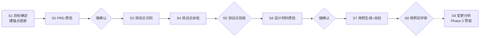

# AI 测试用例智能生成方案

> **根因**：现状把质量全寄托在「提示词叮嘱」上，无工程机制兜底。
> **对策**：单发提示词升级为「工作流 + 多智能体 + skill + harness」四层体系，质量由机制保证。
> 现状材料见 `参考资料/当前提示词/`；改进即本仓库 `@test-expert` 已实现架构，细节以 DESIGN.md 与 skill 原文为准。

## 一、现状分析

**现状**：两段式单发提示词（测试点生成 → 用例生成），150+ 行指令一次调用出终稿——无中间产物、无校验、无人工介入点。

**质量无法保证的根本原因**（共性：全靠模型自觉，无机制兜底）：

1. **纯提示词工程**：一次性黑盒生成，错了无法定位只能整体重跑；「避免臆造」「覆盖全面」全是祈使句，无校验手段；知识内嵌提示词，定义漂移、无法演进
2. **输入质量及质检**：PRD 经 `{input}` 原样注入，矛盾、歧义、缺口不检查；无版本管理，PRD 被静默替换无人知晓
3. **测试点、测试用例的定义、粒度界定及复核**：TP 无出处要求，臆造无法检测、验收指不回原文；「至少大于5条、尽可能更多」数量成隐性 KPI，粒度失控；「相似度大于50%」无客观判据，结论不可复现
4. **其它**：无人工把关点，错误后置、返工最贵；无状态与基线，每次全新生成，历史确认成果丢失

## 二、改进方案

**总思路**：从「提示词工程」升级为「体系工程」——工作流管节奏、多智能体管分工、skill 管知识、harness 管校验。

### 2.1 总体架构：四层分工

| 层 | 承担者 | 职责 |
|---|---|---|
| 编排层 | `@test-expert`（唯一入口） | 阶段推进、人工门禁、状态管理；不含领域知识 |
| 执行层 | 专职 subagent | 按阶段调度：侦察、质检、识别、自检、生成、评审；单个只聚焦一个阶段 |
| 知识层 | skills（即插即用） | 定义、判据、检查单；各自唯一权威源 |
| 工程层 | harness | PRD 快照 + 指纹、锚点底册、validate.sh、覆盖对照表、00-state |

### 2.2 工作流：八阶段四门禁

| 现状问题 | 改进机制 |
|---|---|
| 两步黑盒出终稿 | 八阶段，每阶段单一职责、有编号产物，可定位、可局部返工 |
| 输入原样透传 | S1 建锚点底册 + PRD 快照（md5 防替换）；S2 五维质检 + 漏锚扫描，源头拦截 |
| 无人工介入点 | 四门禁强确认（S2/S5/S6/S8），只认 `通过` / `调整@<编号>` / `退回`，不通过不推进 |
| 错了整体重跑 | 验收通过即基线，编号只增不改；变更先登记、标记失效、只重跑受影响阶段 |

### 2.3 Harness 工程：把叮嘱变成机器校验

| 老叮嘱（现状提示词） | 新机制 |
|---|---|
| 「避免臆造」 | 锚点底册 + ≤40 字摘录逐字机验，编造依据直接报错 |
| 「保证JSON的结构正确」 | validate.sh：编号唯一、必填非空、列序契约、引用完整；退出码非 0 禁止提交 |
| 「覆盖全面」「确保完整性」 | 锚点→TP、TP→TC 覆盖对照表，未覆盖必须写原因 |
| 「相似度大于50%」 | 矛盾检测矩阵：检索交工具、判定写依据、结论留痕 |
| （无对应物） | PRD 快照由命令行生成、禁止模型转写；md5 每次开工重算 |
| （无对应物） | 自检留痕「发现→修复→复核」，禁止只报告不修复 |

两关分工：语义关人工逐项 + 形式关脚本必跑，**脚本 PASS ≠ 自检通过**。

### 2.4 多智能体：编排者 + 专职执行者

对外唯一入口，对内按阶段调度专职 subagent——唯一的是入口与权威源，拆开的是认知负荷：

- 每个执行者只扛一个阶段的指令与上下文，不再 150 行一口吞，结果更稳定
- 编排者先过 validate.sh 与覆盖对照，再交人工强确认；不合格只重做该阶段，不推倒全局
- 分层铁律：agent 管流程，领域知识下沉 skill；跨层只指针引用、禁止复述

### 2.5 Skill 即插即用：知识模块化、权威源唯一

| Skill | 唯一职责 |
|---|---|
| test-point-spec | TP 定义：切分硬标准、命名、清单模板 |
| test-case-spec | TC 定义：十字段、质量标准、清单模板 |
| prd-quality-check | 五维质检、锚点规则、矛盾检测矩阵 |
| test-analysis-methods | 八种方法选用矩阵 + 银行/Web/接口领域检查单 |
| self-review-checklist | 自检清单、覆盖对照表、validate.sh |

收益：**定义不漂移**（唯一权威源）、**独立演进**（改规则不动流程）、**按需插拔**（领域检查单按目标加载，change-impact-analysis 为 Phase 3 预留插槽）。

### 2.6 新旧对照总表

| 根因方面 | 对策 | 落点 |
|---|---|---|
| ① 纯提示词工程 | 八阶段工作流；validate.sh 硬校验；知识下沉 skill | 工作流 + harness + skills |
| ② 输入质量及质检 | 五维质检 + 漏锚扫描；快照 + md5 指纹 | S1/S2 + harness |
| ③ TP/TC 定义、粒度与复核 | 锚点底册 + 逐字机验；TP 收拢业务能力、数量不作目标；矛盾矩阵 + 覆盖对照表 | skills + S4/S7 |
| ④ 过程与状态管理 | 四门禁强确认；00-state + 基线管理 + 编号只增不改 | 全流程 |

**收益**：可追溯（条条指回 PRD）、可复现（机判留痕）、可演进（模块独立升级）。
**分期**：S1–S8 已落地；S9 变更分析为 Phase 3 预留。

## 三、影响质量的其它关键因素

工程体系之外，两个前置因素同样决定产物质量上限：

1. **输入质量**：机器校验拦不住源头缺陷——① 需求平台产出高质量 PRD：结构化、无矛盾、表述可测试；② 测试资产库沉淀：历史 TP/TC 反哺生成与召回，**待讨论：沉淀粒度**（按功能 / 按 TP / 按 TC，粒度决定召回命中率与维护成本）
2. **TP、TC 的定义**：定义是源头契约——切分、命名、校验规则全部由它派生，定义不清或漂移则后续机制全部失准；须守住 test-point-spec / test-case-spec 唯一权威源，定义演进须同步清单模板与 validate.sh，防止定义与校验脱节
