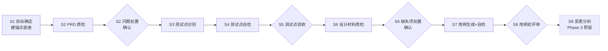

# 测试专家 Agent 设计文档

> 本文面向团队成员，说明 `@test-expert` 的工作方式与设计取舍。分工：**agent 只管流程编排**（阶段、门禁、状态），**领域知识全在 skills**（定义、判据、检查单、模板），双方互相只引用、不复述，权威源缺的知识先落进 skill 再引用。测试点/测试用例的权威定义在 `test-point-spec` / `test-case-spec`，本文只转述要点，有出入以 skill 原文为准。

## 1. 它做什么

**输入** PRD、设计文档、接口文档等研发资产；**输出** 每条都能指回 PRD 原文的测试点（TP）与测试用例（TC）；**过程** 分 8 个阶段推进，4 处人工门禁（强确认）不通过不推进，S9 为 Phase 3 预留。

| 老问题 | 对策 |
|---|---|
| 测试点无依据，指不回需求原文 | 每条 TP 挂 PRD 锚点并附 ≤40 字原文摘录，无依据禁止产出 |
| 粒度失控：按字段碎拆，或多条规则挤进一条 | TP 收拢到业务能力（三条切分标准）；数据、步骤等细节归 TC |
| 术语漂移：测试项/检查点/用例点混用 | TP、TC 各只有一处定义源，禁止口语变体 |
| 一致性漏检不稳定（两次运行结果不同） | 矛盾检测矩阵：检索交给工具，判定依据写明，结论留痕 |

## 2. 核心概念：测试点与测试用例

### 2.1 一句话分清

| | 测试点（TP） | 测试用例（TC） |
|---|---|---|
| 回答的问题 | **验证什么**业务能力 | **具体怎么验** |
| 定义 | 一项供产品确认、能判定通过与不通过的业务验证目标 | 一条含完整执行信息的可执行验证，只验证一个目的（一个 pass/fail 结论） |
| 内容 | 验证意图 + PRD 依据（锚点+摘录） | 前置条件、测试数据、操作步骤、预期结果 |
| 判定方式 | 所含 PRD 要求全部满足才通过，任一不满足即不通过 | 按预期结果直接判定 |
| 数量关系 | 一条 TP 派生一至多条 TC（超 10 条须在自检记录写明原因） | 每条 TC 只能挂一个 TP |

### 2.2 测试点（TP）

测试数据、操作步骤、具体预期归 TC；TP 不按字段、输入值、角色逐项拆分，**数量不作为目标**。一条 TP 必须同时满足三条，缺一不许出：

| 硬标准 | 判据 | 典型违规 |
|---|---|---|
| ① 说得出出处 | 挂 PRD 原文锚点 + ≤40 字摘录，验证的事就是该句原文说的事；PRD 没写的须注明推导来源、挂最相关原文、不与明文矛盾 | 无依据硬出；借一句话验它没说的内容 |
| ② 切得不多不少 | 同一业务能力下的并列条件合成一条；仅三种情况拆分：不同业务目标 / PRD 明文规定不同流程、规则、权限或结果 / 主副项验收不同 | 太大（多条规则塞一条）；太小（同一规则换数据就拆）；重复（明细验证与能力验证各出一条） |
| ③ 判得了对错 | 能回答「真执行了，看什么分出过/不过」 | 答不上来仍硬出 |

- PRD 对并列条件是否区别处理没说清 → 默认合并一条，同时把疑问记入问题清单要求澄清，不得自行补造规则；通过标准定不出来 → 标记待澄清，不算已确认基线
- 命名：「验证」+ 对象 + 结果方向，≤30 字；对象直抄 PRD 原词——名称是未来用例库的检索键，不自创同义词

| 示例 | 判定 |
|---|---|
| 验证超单笔限额的转账被拒绝 | ✅ 一条逻辑、一个结果方向、PRD 原词 |
| 验证转账功能正确 | ❌ 几条不同业务规则塞一条，没法判 |
| 验证输入 0 元和负数均被拒绝 | ❌ PRD 对两者写的是同一套处理，具体数据是用例的事 |

### 2.3 测试用例（TC）

执行者无需追问即可照做。十个字段：

| 字段 | 要求 |
|---|---|
| 编号 | `TC-<功能码>-NNN`，三位序号唯一、只增不改不复用 |
| 标题 | 「场景 + 预期」，如「金额超单笔限额，交易拒绝并提示」 |
| 关联 TP | 单个 TP 编号，禁止多值 |
| 优先级 | P0 核心主流程 / P1 重要分支与边界 / P2 次要场景 / P3 罕见与健壮性 |
| 前置条件 | 可构造的具体状态；环境/版本要求也写入此项，禁止「系统正常」类空话 |
| 测试数据 | 具体值，金额/字段给到具体数值 |
| 操作步骤 | 动词开头、编号分步、无歧义词 |
| 预期结果 | 可判定的具体值/文案/状态，多个结果分点写 |
| 用例类型 | 正向/反向/边界/异常/流程；交叉时按 边界>异常>反向>流程>正向 取首个命中 |
| 变更状态 | Phase 3 预留，生成时一律留空 |

## 3. 关键机制词典

| 机制 | 是什么 | 防什么 |
|---|---|---|
| 锚点 | PRD 原文的定位标记：PRD 自带编号就用原文编号，没有则按 `M<模块>-S<章节>-P<段落>` 生成 | 说不清验证的是 PRD 哪句话 |
| 锚点底册 | 01-scope.md 中的锚点清单表，全流程唯一溯源依据；S1 建立并验收后冻结 | 各阶段随手加锚、依据漂移 |
| 引用链登记 | S1 逐条登记「目标功能各处引用了哪些其他功能、操作入口归谁」，作为 S2 的检索入口 | 跨功能引用被漏检 |
| PRD 文本快照 | S1 用命令行工具把 PRD 转成纯文本落盘 `00-input/prd.txt`，禁止模型转写 | 模型转写改写原文 |
| 摘录逐字机验 | validate.sh 校验底册摘录 ≤40 字且逐字命中快照（比对前去除多余空白），TP 依据含对应底册摘录 | 凭空编造依据 |
| 版本指纹 | S1 登记 PRD 原文件 md5，每次开工重算比对 | PRD 被静默替换 |
| 漏锚扫描 | S2 末尾用功能名等原词在快照全文搜索，逐处判定「已建锚/疑似缺锚/范围外」；缺锚经用户确认并在 00-state.md 登记后补录——这是底册冻结的唯一例外 | 底册本身有遗漏而无人发现 |
| 强确认协议 | 门禁只接受三种答复：`通过` / `调整@<编号> <说明>` / `退回`，其他一律视为未确认 | 「嗯」「先继续」被当成确认 |
| 功能码 | ≤6 字符拼音/英文缩写（如 LBZS），仅用于 TP-/TC- 编号；引用功能名称必须与 PRD 原文逐字一致（规则见 prd-quality-check） | 编号占位与名称引用混淆 |
| 问题分级 | 仅两级：**Blocker**（无法定义或判定 TP）/ **Major**（可暂定 TP，但未决问题可能改变范围、拆分或验收结果）；不影响 TP 生成与判定的细节不进问题清单、不登记、不展示 | 细枝末节淹没关键问题 |
| 产出模式 | **演示模式**（默认，不写文件，机器校验降级为对话内口头确认）/ **落盘模式**（写全套产物并跑 validate.sh）；两模式的阶段顺序、门禁、溯源要求完全一致，仅产物载体不同 | — |

## 4. 工作流：八个阶段

> 菱形 = 人工门禁（强确认，不通过不推进）；S1 用户指定目标功能即视为确认。

| 阶段 | 做什么 | 产出 | 门禁 |
|---|---|---|---|
| S1 目标确定 | 通读 PRD → 列功能清单（名称逐字引原文、拟功能码）→ 用户指定目标功能 → 引用链登记 + 建锚点底册 → 生成 PRD 文本快照、登记指纹 | 01-scope.md | 无：用户指定即确认 |
| S2 PRD 质检 | 五维质检 + 矛盾矩阵比对 → 漏锚扫描（缺锚经确认补录） | 02-prd-check.md | 强确认：问题处置 |
| S3 测试点识别 | 先广撒网列全覆盖维度，再按切分标准定成业务验证目标 | 03-test-points.md 草稿 | 无：进自检 |
| S4 测试点自检 | 语义逐项核对 + 跑脚本校验 | 03 定稿 + 覆盖对照表 | 无：进验收 |
| S5 测试点验收 | 发起测试点验收 | 00-state.md 确认记录 | 强确认 |
| S6 设计材料质检 | 用户提供接口文档/数据字典/设计文档/流程图，按材料类型补查 TC 所需细节；用底册核对 PRD 已明确约束的覆盖方式 | 04-design-check.md | 强确认：缺失项处置 |
| S7 用例生成+自检 | 基于验收通过的 TP 与补齐材料生成 TC + 自检 | 05-test-cases.md 定稿 + 覆盖对照表 | 无：进评审 |
| S8 用例初评审 | 发起用例初评审 | 00-state.md 确认记录 | 强确认 |
| S9 变更分析 | Phase 3 预留，暂不展开 | — | — |

- **单一功能边界**：一次只做一个业务功能；切换须显式挂起并在 00-state.md 登记
- **状态恢复**：开工先读 00-state.md 并与各产物条目数核对；不一致先向用户求证，不盲信 state 也不盲信文件
- **基线管理**：验收通过的清单即基线，此后只做受控变更（失效/新增/修改）；编号只增不改不复用，禁止无差别重新生成
- **材料变更**：登记变更说明 → 受影响 TP/TC 标记失效 → 明确告知需重跑哪些阶段

## 5. 质检与自检

### 5.1 PRD 质检（S2）

五维检查：完整性、一致性、无二义性、可测试性、可追溯性。检查深度只要求 PRD 能支撑「有依据、范围清楚、结果可判定的业务级 TP」，不要求已具备编写全部 TC 的细节。能用工具查的不用模型猜，模型判断必须写明依据。

一致性维度不凭印象检索，按固定流程执行：

| 机制 | 规则 |
|---|---|
| 矛盾检测矩阵 | 6 个维度（数据可见范围/操作入口与按钮归属/状态流转/角色能力/字段与统计标准/时间与触发条件）× 种子词表：先用检索工具在 PRD 全文定位，再两两比对，结论（兼容/冲突/无法判定）留痕；6 个维度是试用清单，须在历史案例（素材积累于 prd-quality-check/baseline/log.md）中验证有效后才转正式 |
| 三问判据 | 「PRD 有意留白」类候选须同时满足：① 明确声明不设硬指标 ② 已给出验证方式（哪怕人工查看）③ 不影响 TP 的归组/拆分/判定——三问全满足则不登记，防误报 |
| 登记前最后一问 | 是否产生两种互斥的预期结果、或改变 TP 归组/拆分/判定？是则登记；仅枚举/清单/参数不全属 TC 级细节，不登记（如「支持部分列排序」未给列清单） |
| 同类横向自查 | 处置完成后，对同页面/同交互层级的候选核对处置是否一致；不一致必须写明实质差异，否则同判 |
| 待核验标记消歧 | 「待核验」标记只吸收该条目自身未定的部分；已写死内容之间的冲突必须登记，不得被标记吸收 |
| 候选留痕 | 全部候选（含不登记的）一行理由入报告附录，供用户质疑；报告末尾邀请用户补充未列出的候选矛盾 |

歧义处置：并列条件未说明不同处理 → 默认合并一条 TP 并记录问题；PRD 明确不同目标/流程/规则/权限/结果 → 分别成 TP。

### 5.2 自检（S4/S7）

**两关分工，脚本 PASS ≠ 自检通过：**

| 关 | 谁来做 | 查什么 |
|---|---|---|
| 语义关 | 人工逐项 | 出处（锚点定位是否正确，摘录逐字由脚本机验）、切分、归组、命名、可判定、高风险判定、覆盖反向核对（逐锚点核对，不能「锚点有对应 TP」就算覆盖完整）、名称与 01 登记原文逐字一致 |
| 形式关 | 脚本必跑 | `bash .opencode/skills/self-review-checklist/validate.sh qa-workspace/<功能> all`：编号格式与唯一性、验证意图以「验证」开头、必填字段非空、TP 依据锚点全在底册、底册锚点全覆盖、TC→TP 引用完整、TP 全覆盖、底册摘录 ≤40 字且逐字命中快照、TP 依据含底册摘录；退出码非 0 必须修复后重跑 |

- **覆盖对照表**：S4 产出锚点→TP 对照、S7 产出 TP→TC 对照；未覆盖项必须显式填写原因，禁止留空
- **自检留痕**：每处修复在产物尾部「自检记录」表留痕（发现→修复→复核）；禁止只报告不修复、只修复不复核
- **列序契约**：03/05 清单模板列顺序不得调整，validate.sh 按列序校验
- **锚点编号捕获**：validate.sh 锚点提取正则支持 PRD 原文双段编号（如 `BR-LIST-01`、`NFR-PERF-01`，可选中间段）与 `M<模块>-S<章节>-P<段落>` 回退格式；TP 依据单元格以首个命中的锚点参与底册归属与摘录包含校验

## 6. 安全边界

- **输入只读**：PRD/设计文档不替用户修改；质检只报告问题与建议
- **产物隔离**：一切产物只写 `qa-workspace/`；不执行删除类命令
- **读完再判**：超长文档分页读完，禁止只读首屏下结论；流程图/截图等不可解析内容显式声明「文本范围外信息缺失，测试点可能不全」并登记缺失项

## 7. 文件地图

| 文件 | 职责 |
|---|---|
| `.opencode/agents/test-expert.md` | 唯一 agent：流程编排、阶段门禁、状态管理 |
| `.opencode/skills/test-point-spec/` | TP 唯一定义源：切分判据、命名、清单模板 |
| `.opencode/skills/test-case-spec/` | TC 唯一定义源：十字段、质量标准、清单模板（含变更状态预留列） |
| `.opencode/skills/prd-quality-check/` | 五维质检、锚点规则、矛盾检测矩阵、三问判据（含 baseline/ 素材记录） |
| `.opencode/skills/test-analysis-methods/` | 八种方法选用矩阵、银行/Web/接口领域检查单 |
| `.opencode/skills/self-review-checklist/` | S4/S7 自检清单、覆盖对照表、validate.sh |
| `.opencode/skills/change-impact-analysis/` | Phase 3 预留骨架（WIP） |
| `qa-workspace/<功能>/` | 运行时产物：01-scope ~ 05-test-cases + 00-state.md |
