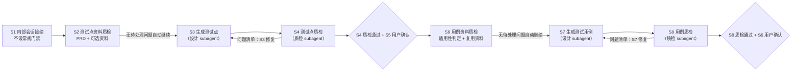

# 测试专家 Agent 设计文档

> 面向团队成员。三个 agent：测试经理 `@test-manager`（主流程）+ 测试设计专家 `@test-designer`（subagent）+ 测试质检专家 `@test-qa-expert`（subagent）。
> 分工铁律：**经理只管编排**（阶段、门禁、状态、双向派发）；**生成与修复归设计专家，检查与结论归质检专家**；**定义、判据、检查单、模板全在 skills**。文件之间只引用、不复述。TP/TC 的权威定义在 `test-point-spec` / `test-case-spec`，本文只转述要点，有出入以 skill 原文为准。

## 1. 它做什么

**输入**：用户预先准备的单功能工作空间。测试点阶段必需=PRD，可选=领域知识、逆向文档、功能知识、存量测试点；用例阶段复用上述资料，另需前端与后端设计（**适用时必需**，无界面功能由经理判定豁免），可选=数据库设计、存量测试用例。**输出**：每条都能指回 PRD 原文的测试点（TP）与测试用例（TC）。**过程**：一个功能一次流程，六步——资料质检、生成、产物质检与用户确认；S2/S6 通过且无待用户处理问题时自动推进，用户确认集中在 S4+S5、S8+S9 两处合并门禁。S2/S4/S6/S8 质检由质检 subagent 执行，S3/S7 生成与修复由设计 subagent 执行。

| 老问题 | 对策 |
|---|---|
| 自己生成自己检查，质检走过场 | 职能三角：编排归经理，生成修复归设计专家，检查结论归质检专家；四个质检阶段一律派发质检，生成与修复一律派发设计 |
| 测试点无依据，指不回需求原文 | 每条 TP 挂 PRD 锚点并附 ≤40 字原文摘录，无依据禁止产出 |
| 粒度失控：按字段碎拆，或多条规则挤进一条 | TP 收拢到业务能力（三条切分标准）；数据、步骤等细节归 TC |
| 术语漂移：测试项/检查点/用例点混用 | TP、TC 各只有一处定义源，禁止口语变体 |
| 一致性漏检不稳定（两次运行结果不同） | 矛盾检测矩阵：检索交给工具，判定依据写明，结论留痕 |
| PRD 被静默替换 / 材料悄悄过期 | PRD 版本锁定 + 指纹核对：一经 S1 确定全流程锁定，流程内不修改 PRD 文件 |

## 2. 核心概念：测试点与测试用例

### 2.1 一句话分清

| | 测试点（TP） | 测试用例（TC） |
|---|---|---|
| 回答的问题 | **验证什么**业务能力 | **具体怎么验** |
| 定义 | 一项供产品确认、能判定通过与不通过的业务验证目标 | 一条含完整执行信息的可执行验证，只验证一个目的（一个 pass/fail 结论） |
| 内容 | 验证意图 + PRD 依据（锚点+摘录） | 前置条件、测试数据、操作步骤、预期结果 |
| 判定方式 | 所含 PRD 要求全部满足才通过，任一不满足即不通过 | 按预期结果直接判定 |
| 数量关系 | 一条 TP 派生一至多条 TC（超 10 条须在质检记录写明原因） | 每条 TC 只能挂一个 TP |

编号规则：`TP-<功能码>-NNN` / `TC-<功能码>-NNN`；功能码=平台 `bizFunctionId`，只作编号、不替代名称；三位序号只增不改不复用；validate.sh 校验编号中的功能码段必须与功能目录名一致。

### 2.2 测试点（TP）

测试数据、操作步骤、具体预期归 TC；TP 不按字段、输入值、角色逐项拆分，**数量不作为目标**。一条 TP 必须同时满足三条，缺一不许出：

| 硬标准 | 判据 | 典型违规 |
|---|---|---|
| ① 说得出出处 | 挂 PRD 原文锚点 + ≤40 字摘录，验证的事就是该句原文说的事；PRD 没写的须注明推导来源、挂最相关原文、不与明文矛盾；用户澄清结论登记后可作依据 | 无依据硬出；借一句话验它没说的内容 |
| ② 切得不多不少 | 同一业务能力下的并列条件合成一条；仅三种情况拆分：不同业务目标 / PRD 明文规定不同流程、规则、权限或结果 / 主副项验收不同 | 太大（多条规则塞一条）；太小（同一规则换数据就拆）；耦合（明细验证与能力验证各出一条） |
| ③ 判得了对错 | 能回答「真执行了，看什么分出过/不过」 | 答不上来仍硬出 |

- PRD 对并列条件是否区别处理没说清 → 默认合并一条，同时把疑问记入问题清单要求澄清，不得自行补造规则；通过标准定不出来 → 标记待澄清，不算已确认基线
- 命名：「验证」+ 对象 + 结果方向，≤30 字；对象直抄 PRD 原词——名称是未来用例库的检索键，不自创同义词

| 示例 | 判定 |
|---|---|
| 验证超单笔限额的转账被拒绝 | ✅ 一条逻辑、一个结果方向、PRD 原词 |
| 验证转账功能正确 | ❌ 几条不同业务规则塞一条，没法判 |
| 验证输入 0 元和负数均被拒绝 | ❌ PRD 对两者写的是同一套处理，具体数据是用例的事 |

### 2.3 测试用例（TC）

执行者无需追问即可照做。十个字段：

| 字段 | 要求 |
|---|---|
| 编号 | `TC-<功能码>-NNN`，三位序号唯一、只增不改不复用 |
| 标题 | 「场景 + 预期」，如「金额超单笔限额，交易拒绝并提示」 |
| 关联 TP | 单个 TP 编号，禁止多值 |
| 优先级 | P0 核心主流程 / P1 重要分支与边界 / P2 次要场景 / P3 罕见与健壮性 |
| 前置条件 | 可构造的具体状态；环境/版本要求也写入此项，禁止「系统正常」类空话 |
| 测试数据 | 具体值，金额/字段给到具体数值 |
| 操作步骤 | 动词开头、编号分步、无歧义词 |
| 预期结果 | 可判定的具体值/文案/状态，多个结果分点写 |
| 用例类型 | 正向/反向/边界/异常/流程；交叉时按 边界>异常>反向>流程>正向 取首个命中 |
| 变更状态 | 预留字段，当前流程（S7/S8/S9）一律留空 |

## 3. 关键机制词典

| 机制 | 是什么 | 防什么 |
|---|---|---|
| 职能三角分工 | 经理（primary）管编排、门禁、状态、S1 与 S4/S5、S8/S9 合并确认、双向派发；设计专家（subagent）做 S3/S7 生成与修复；质检专家（subagent）做 S2/S4/S6/S8 检查，只检不修、不与用户交互 | 自己检自己走过场；生成者与质检者越权写文件 |
| 文件写权限矩阵 | prd.txt、scope.md、state.md 归经理；两个产物文件归设计专家（标题行状态字样可由经理变更）；四份质检报告归质检专家；输入材料无人可写。agent edit 权限按矩阵按角色精确到文件，输入材料与 skill 目录写入一律 ask | 越权写入无人发现；输入原件被静默改写 |
| 双向派发与会话复用 | 经理派发单必含：阶段与任务、路径、资料质检报告、材料清单、需加载 skill、写入授权、禁止修改项。设计专家交稿前跑对应模式校验并返回产物 SHA-256；经理只在指纹不符或缺少校验记录时补跑，发现机械性 FAIL 转派设计即时修复（复用会话，不消耗质检轮次）；质检专家对最终产物正式校验；validate.sh 已列入三 agent 命令白名单，其余 bash 仍需批准 | 缺材料凭空生成；重复往返校验；副手自查被权限闸卡死 |
| 运行时目录 | `workspace/runtime_<项目>/file/<bizFunctionId>/`：只读输入（prd-doc、develop-docs、domain-knowledge、asset-library、code）+ prd.txt 快照 + output/ 共享产物；会话目录 `<uuid>/`：scope.md、state.md、input/、四份质检报告。骨架用户预建，agent 不建不删目录 | 输入与产物混放；会话产物串功能 |
| 两阶段资料质检 | S2 检查 PRD 并登记领域知识、逆向文档、功能知识、存量测试点；S6 复核 S2 资料与已验收 TP、检查适用设计、登记数据库设计与存量测试用例。可选缺失标「未提供」继续；必需问题请用户澄清 | 资料缺口导致空转；同一资料反复读取 |
| 资料缺口处置 | 经理先判设计适用性：无界面功能（纯接口/纯算法等）登记「前端设计不适用」继续，判定存疑请用户确认；判定为必需的设计缺失/不可读时暂停 S7 并请用户澄清或补充；数据库设计、存量测试用例等可选缺失标「未提供」继续 | 把无界面功能硬塞份前端设计；把必需缺口误当可选项；无依据硬造 TC |
| 锚点 | PRD 原文的定位标记：PRD 自带编号就用原文编号，没有则按 `M<模块>-S<章节>-P<段落>` 生成 | 说不清验证的是 PRD 哪句话 |
| 锚点底册 | 会话目录 scope.md 中的锚点清单表（锚点 + 条目摘要 + ≤40 字原文摘录），全流程唯一溯源依据；S1 建立后冻结，唯一例外是漏锚扫描经用户确认后的受控补录（state.md 登记补录版本） | 各阶段随手加锚；依据漂移 |
| 引用链登记 | S1 逐条登记目标功能各处引用了哪些其他功能、操作入口归谁，作为 S2 检索入口；不展开被引功能全文 | 跨功能引用被漏检 |
| PRD 文本快照 | S1 用 snapshot 模式把权威 PRD 转纯文本落功能目录 `prd.txt`，禁止模型转写；生成时统一引号归一（弯→直），归一后字符是全链路唯一基准（底册摘录、TP 依据、TC 文案引用一律以其为准）；快照只读、已存在即拒绝重建，重开需用户先移除旧快照；内嵌图片等不可解析内容**先自行解读**（标「AI 解读待确认」），无法解读才降级声明并交用户确认 | 模型转写失真；引号不一致导致机验误判；把系统能消除的不确定性推给用户 |
| 摘录逐字机验 | validate.sh 校验底册摘录 ≤40 字且逐字命中快照（比对前去除多余空白），TP 依据必须含对应底册摘录；摘录用 `pull <锚点>` 模式程序化提取（先自验命中再输出），禁止手抄 | 凭空编造依据；手抄摘录字符漂移 |
| PRD 版本锁定 | S1 登记权威 PRD 原件 md5，每次开工重算比对；流程内不修改 PRD 文件，问题一律靠澄清登记。指纹不一致 → 暂停，用户二选一：恢复原 PRD（指纹复原后继续），或挂起本功能按新 PRD 重开（旧快照由用户移除后重建） | PRD 被静默替换；底册、快照、指纹整体失效 |
| 漏锚扫描 | S2 末尾用功能名等 PRD 原词在快照全文逐词检索，按章节聚合，逐处判定「已建锚/疑似缺锚/范围外」；缺锚经用户确认并登记后补录底册 | 底册漏锚导致系统性漏测 |
| 强确认协议 | 门禁基础答复只有三种：`通过` / `调整@<编号> <说明>` / `退回`，其余一律视为未确认。`通过 <阶段名>` + 处置映射（`@<编号>=<结论>`）= 处置性通过：处置以 CL 编号登记 state.md 后本轮即通过，处置记录由下一阶段质检补录（有未消解 Blocker 时无效）。Blocker 带风险推进须 `通过 + 阶段名` 二次确认并登记风险 | 「嗯」「先继续」被当成确认；澄清与通过被拆成两轮空等 |
| 门禁转移与合并确认 | S2/S6 无待用户处理问题自动推进，需澄清时只复查受影响项；S4+S5、S8+S9 各合并为一次确认：先列质检结论（报告要点 + validate.sh 结果），再列产物清单，「通过」同时完成质检认可与验收/评审。修订后的产物必须复检 | 确认轮次冗余；「退回」被随意解释；改完跳过质检 |
| 修复循环 | S3↔S4、S7↔S8：问题清单 → 修复（产物尾部质检记录表留痕）→ 复检（报告按轮次追加）→ 全部消解且 validate.sh 通过 → 定稿 → 合并确认 | 修复无痕；复检覆盖历史 |
| 问题分级与处置 | 仅两级：**Blocker**（无法定义或判定 TP/TC）/ **Major**（可暂定，但未决问题可能改变范围、拆分或结果）。S4/S8 逐条标注处置方：产物级走修复循环；输入/基线级（PRD 歧义、材料缺口、TP 基线错误）立即暂停循环呈报用户。不影响生成与判定的细节不进问题清单 | 枝末节淹没主问题；输入级问题在循环内硬编硬造 |
| 收敛保护 | 同一质检阶段连续 3 轮仍有未解决问题 → 暂停循环，用户裁定 | 无限空转 |
| 资料结论复用 | 质检报告记录路径、版本/指纹（可取得时）与检查范围；后续阶段复用未变化资料的结论，只读变化项与当前目标相关章节 | 同一长文档在质检、生成、复检中反复完整阅读 |
| TP 全覆盖豁免 | TP 覆盖表填写「未覆盖原因」即被脚本放行；S8 质检还须核对 state.md 中对应的用户澄清或风险记录，没有有效用户决定不得通过；必需资料未解决时不能靠填原因放行 | 机械豁免被误当作业务批准 |
| 功能码 | 平台 `bizFunctionId` 直接派生（无注册表文件），仅作 TP/TC 编号；引用功能名称必须与 PRD 原文逐字一致（规则见 prd-quality-check） | 编号占位与名称引用混淆 |
| 经验回灌 | 流程完成后把本次检出的新问题模式登记 prd-quality-check baseline/log.md 并提出 skill 修订；产物与基线随 git 持久化，工作空间重建先从 git 历史恢复（前提：运行时目录在 git 工作区内，否则由平台归档承接） | 同类问题跨功能跨项目重演 |

## 4. 工作流：六个核心步骤

> S1 的会话接续与范围记录是内部操作；S2/S6 资料质检通过且无待处理问题时自动推进。用户确认集中在测试点和测试用例两处；必需资料或 PRD 存在问题时，暂停并请用户澄清/补充。

| 阶段 | 执行者 | 做什么 | 产出 | 门禁 |
|---|---|---|---|---|
| S1 内部会话接续 | 测试经理 | 定位用户预建的单功能工作空间；读取状态、核对 PRD 指纹；需要时建立快照、scope.md 和 state.md。仅范围或权威 PRD 不明确时询问用户 | scope.md、state.md、prd.txt | 无常规门禁 |
| S2 测试点资料质检 | 质检 subagent | PRD 五维质检、矛盾检查、漏锚扫描；登记领域知识、逆向文档、功能知识、存量测试点的路径、可读性与相关性 | prd-check.md | 无待用户处理问题时自动进入 S3；PRD 问题需澄清后复查 |
| S3 生成测试点 | 设计 subagent | 基于质检通过的 PRD 和已登记可用资料识别、收敛测试点，随清单产出覆盖对照表；承担 S4 产物级问题修复 | test-point.md 草稿（含覆盖对照表） | 无：进入 S4 |
| S4+S5 测试点质检与确认 | 质检 subagent + 测试经理 | 质检专家做语义检查与正式脚本校验，核对覆盖对照表；产物问题交 S3 修复；通过后经理向用户展示报告和 TP 清单并确认 | tp-check.md、已验收 test-point.md、state.md 确认记录 | 强确认 |
| S6 用例资料质检 | 质检 subagent（经理先做适用性判定） | 经理判定功能有无操作界面，无界面登记「前端设计不适用」（存疑请用户确认）；质检专家复核适用性判定，检查 S2 资料和已验收 TP 是否可复用，检查适用时必需设计；登记数据库设计、存量测试用例可用性 | design-check.md | 无待用户处理问题时自动进入 S7；适用性存疑或必需设计问题需澄清/补充 |
| S7 生成测试用例 | 设计 subagent | 基于同一 PRD、已验收 TP、复用资料、适用设计及可用可选资料生成用例和 TP→TC 覆盖对照表；承担 S8 产物级问题修复 | test-case.md 草稿（含覆盖对照表） | 无：进入 S8 |
| S8+S9 测试用例质检与确认 | 质检 subagent + 测试经理 | 质检专家做语义检查与正式脚本校验，核对覆盖对照表；产物问题交 S7 修复；通过后经理向用户展示报告和 TC 清单并确认 | tc-check.md、已评审 test-case.md、state.md 确认记录 | 强确认 |

- **资料输入模型**：S3 必需=当前业务功能 PRD；可选=领域知识、逆向文档、功能知识、存量测试点。S7 必需=同一测试点资料包 + 已验收 TP + 前端/后端设计（适用时必需：经理在 S6 按功能有无界面判定，无界面登记「前端设计不适用」继续）；可选=数据库设计、存量测试用例。可选缺失/为空标注「未提供」继续；存在但不可读不得静默跳过。必需资料问题暂停请用户澄清或补充；风险推进需二次确认并登记。具体来源见 `DESIGN/工作空间目录结构.md`。
- **单一功能边界**：一次只做一个业务功能；切换须显式挂起并在 state.md 登记
- **状态恢复**：开工先读活跃会话目录 `<bizFunctionId>/<uuid>/state.md` 并与各产物条目数核对；不一致先向用户求证，不盲信 state 也不盲信文件
- **基线管理**：验收通过的清单即基线，此后只做受控变更（失效/新增/修改）；编号只增不改不复用，禁止无差别重新生成
- **资料变更**：PRD 以外的 S2/S6 输入材料变化时，经理登记变更 → 质检专家只复查变化项 → 设计 subagent 仅标记、修改受影响 TP/TC → 受影响产物重跑质检和用户确认；未受影响基线保留。PRD 文件变更暂不支持（版本锁定）

## 5. 质检机制（职能三角）

### 5.1 分工与派发

- 编排、门禁、状态归测试经理；生成与修复归测试设计专家；检查与结论归测试质检专家，只检不修；两个 subagent 均不与用户交互
- 经理双向派发：S3/S7 生成与修复 → 设计专家；S2/S4/S6/S8 → 质检专家；派发单必含项见机制词典「双向派发与会话复用」
- 会话复用：同一功能同一产物线默认复用 subagent 会话，失效即新开重发完整派发单
- 收回核验：实际写入文件列表与派发授权一致才接收；越权写入 → 暂停报告用户，不自动回滚

### 5.2 PRD 质检（S2）

五维检查：完整性、一致性、无二义性、可测试性、可追溯性。检查深度只要求 PRD 能支撑「有依据、范围清楚、结果可判定的业务级 TP」。同时登记领域知识、逆向文档、功能知识、存量测试点的路径、可读性和相关性；可选资料缺失不阻塞，存在但不可读或与 PRD 存在实质冲突时交经理请用户处理。无待用户处理问题时自动进入 S3。规则见 prd-quality-check。

### 5.3 两关质检（S4/S8，规范见 self-review-checklist）

| 关 | 谁来做 | 查什么 |
|---|---|---|
| 语义关 | 质检 subagent 逐项 | 出处、切分、归组、命名、可判定、高风险判定、覆盖反向核对（逐锚点）、去重、名称与 scope.md 登记原文逐字一致 |
| 形式关 | 脚本必跑 | S4 传 `test-point`、S8 传 `test-case` 模式（会话目录作入口，产物在功能目录 output/；禁止 `all`）：编号格式与唯一性（功能码=平台 bizFunctionId，且与功能目录名一致）、必填字段、锚点底册引用与全覆盖、摘录逐字机验、TC→TP 引用完整、TP 全覆盖（含豁免） |

- **脚本 PASS ≠ 质检通过**；两关都过才可定稿并发起合并确认
- 问题清单逐条标注级别与处置方；产物级走修复循环，输入/基线级立即呈报用户
- **覆盖对照表**：S3 产出锚点→TP 对照（S4 核对补原因）、S7 产出 TP→TC 对照（S8 核对）；未覆盖项必须显式填写原因，禁止留空

### 5.4 用例资料质检（S6，规范见 tdd-quality-check）

检查深度 = 支撑 TC 十字段生成。经理先做设计适用性判定：无界面功能（纯接口/纯算法等）登记「前端设计不适用」继续，判定存疑请用户确认；质检专家复核判定。适用时必需的设计任一缺失或不可读时暂停并请用户澄清/补充；数据库设计与存量测试用例为可选材料，缺失标「未提供」继续。无待用户处理问题时自动进入 S7。未变化资料复用既有结论，只检查变化项与已验收 TP 相关章节；细则见 tdd-quality-check。

## 6. 安全边界

- **输入只读**：需求文档、设计文档、领域知识、逆向文档、功能知识、存量测试资产不替用户修改；S2 对 PRD 仅支持澄清/补充说明（登记不落原件）；agent edit 权限已按写权限矩阵按角色收窄，输入材料写入默认 ask
- **产物隔离**：一切产物只写 `workspace/runtime_<项目>/file/` 体系；不执行删除类命令，目录不建不删；旧快照、旧产物的移除与归档请用户或经同意的归档操作完成
- **按范围读并留痕**：PRD 检查须覆盖目标功能所需需求依据；设计资料先查目录、全局规则，再深读已验收 TP 相关章节及交叉引用；不得只读首屏；报告记录检查范围和限制，未变化资料复用既有结论；图表等不可解析内容按 prd-quality-check 的降级规则处理

## 7. 文件地图

| 文件 | 职责 |
|---|---|
| `AGENTS.md` | 项目规则总纲：对人与未来 agent 生效的约定（术语权威源、编号体系、门禁与校验纪律） |
| `.opencode/agents/test-manager.md` | 主流程 agent（测试经理）：内部会话接续、状态、澄清、S4/S5 与 S8/S9 合并确认、资料清单、双向派发与收回核验 |
| `.opencode/agents/test-designer.md` | 生成 agent（subagent）：S3 测试点生成、S7 用例生成、S4/S8 产物级修复；只生成修复、不质检 |
| `.opencode/agents/test-qa-expert.md` | 质检 agent（subagent）：S2 测试点资料、S4 测试点、S6 用例资料、S8 测试用例质检；只检不修 |
| `.opencode/skills/test-point-spec/` | TP 唯一定义源：切分判据、命名、清单模板 |
| `.opencode/skills/test-case-spec/` | TC 唯一定义源：十字段、质量标准、清单模板（含预留变更状态列） |
| `.opencode/skills/prd-quality-check/` | PRD 五维质检、测试点可选资料清单、锚点规则、矛盾检测矩阵、三问判据、问题分级 |
| `.opencode/skills/tdd-quality-check/` | S6 用例资料质检：复用 S2 资料、前后端适用时必需设计（无界面功能登记不适用）、数据库设计和存量用例可选 |
| `.opencode/skills/test-analysis-methods/` | 八种方法选用矩阵、银行/Web/接口领域检查单 |
| `.opencode/skills/self-review-checklist/` | S4/S8 质检清单、问题分级与处置方、覆盖对照表、validate.sh |
| `DESIGN/工作空间目录结构.md` | 运行时目录结构契约（工作空间与物理存储两层） |
| `DESIGN/PRD编写约束要求.md` | 需求侧 PRD 编写与交稿自检约束（供随需求模板下发） |
| `DESIGN/前端设计编写约束要求.md` | 需求侧前端设计文档编写与交稿自检约束（配合同名 PRD，服务用例生成 S6~S8；供随需求模板下发） |
| `workspace/runtime_<项目>/file/` | 运行时工作空间：业务功能目录（只读输入 + prd.txt 快照 + output/ 共享产物 test-point、test-case）+ 会话目录 `<uuid>/`（input/ + scope.md、state.md + 四份质检报告） |

> 迁移说明：主流程 agent 原 `test-expert.md`（角色「测试设计专家」）已在职能三角改造中改名 `test-manager.md`（角色「测试经理」），旧唤起名 `@test-expert` 不再有效；生成职能移入 `test-designer.md`。
