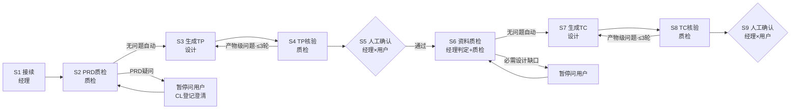

# 测试用例生成团队设计文档

> 本文档是测试用例生成团队的设计总纲，面向团队成员与后续维护者，依次介绍：团队定位与角色分工、核心概念、工作流编排与流转调度设计、各阶段运行机制、工作区目录结构（含每个文件的出处）以及注意要点。

## 1. 团队介绍

**这个团队是干嘛的**：基于用户准备的需求文档（PRD）及配套资料，为**一个业务功能**生成可溯源的测试点（TP）与测试用例（TC）。团队的铁律是**一切测试内容必须有据可查**——每条测试点挂 PRD 锚点（原文证据），每条用例挂测试点，机器校验摘录逐字命中 PRD 快照，从机制上杜绝 agent 编造测试内容。

**三个角色**：

| 角色 | agent | 职责边界 | 与用户交互 |
|---|---|---|---|
| **测试经理** | `@test-manager`（primary） | **只负责流程编排**：按 S1~S9 状态机驱动流转、向用户发起确认、双向派发任务、收回核验、登记状态 | ✅ 唯一交互角色 |
| **测试设计专家** | `@test-designer`（subagent） | **负责生成**：生成测试点（S3）、生成测试用例（S7）、按质检报告修复产物级问题 | ❌ |
| **测试质检专家** | `@test-qa-expert`（subagent） | **只负责质检核验**：PRD 资料质检（S2）、TP 核验（S4）、设计资料检查（S6）、TC 核验（S8），只检不修 | ❌ |

三角制衡：生成者不自检（质检专家独立核验），检查者不修复（问题交回设计专家），两个 subagent 互不隶属、互不对话，全部经经理派发与收回——防止"自己生成自己检查走过场"。

## 2. 核心概念

| 术语 | 含义 |
|---|---|
| **测试点（TP）** | 一项可判定通过/不通过的**业务验证目标**，回答"验证什么"。须同时满足三条硬标准：说得出出处（挂锚点+≤40字摘录）、切得不多不少（按业务能力切，不按字段切）、判得了对错 |
| **测试用例（TC）** | 一条含完整执行信息（前置条件/测试数据/操作步骤/预期结果）的**可执行验证**，回答"怎么验"，一条只验证一个 pass/fail 目的。十个字段 |
| **锚点** | PRD 原文的定位标记（原文编号或 `M<模块>-S<章节>-P<段落>` 派生），相当于证据的"门牌号"。一节含多条独立硬规则时细分到子句级 |
| **锚点底册（scope.md）** | 目标功能全部锚点的登记表（锚点+条目摘要+≤40字原文摘录），**全流程唯一证据底册**。建立后冻结，唯一例外是缺锚经用户确认后的受控补录 |
| **PRD 文本快照（prd.txt）** | 权威 PRD 转纯文本（程序转换+引号归一，禁止模型转写），是摘录逐字机验的字符基准 |
| **功能码** | TP/TC 编号中的功能段，直接取平台 `bizFunctionId`（即功能目录名），只作编号用途、不替代名称；编号 `TP-<功能码>-NNN`，序号只增不改不复用 |
| **覆盖对照表** | 锚点→TP、TP→TC 的双向映射表，随清单产出；"底册每个锚点被 TP 覆盖、每个 TP 被 TC 覆盖"，未覆盖必须写原因，脚本机验映射一致性 |
| **门禁（人工确认）** | 产物定稿前的用户确认点，只有 `通过` / `调整@<编号> <说明>` / `退回` 三种合法答复 |
| **Blocker / Major** | 问题两级：Blocker=无法定义或判定 TP/TC；Major=可暂定但未决问题可能改变范围、拆分或验收结果 |
| **产物级 / 输入·基线级** | 问题处置方分类：产物级=生成者可修，走修复循环；输入·基线级=PRD 歧义、材料缺口、基线错误，必须立即呈报用户，禁止在循环内硬编硬造 |
| **validate.sh** | 机械校验脚本：编号格式、必填字段、锚点引用、摘录逐字命中快照、覆盖双向映射、TC→TP 引用完整性、漏锚扫描候选、摘录程序化提取等 |

## 3. 工作流编排与流转调度设计

### 3.1 流程总览



### 3.2 流转调度规则

1. **人工确认只有两处**（S5、S9）：产物定稿前的强确认，质检结论与产物清单同屏呈现，一次确认同时完成"质检认可+验收/评审"。其余阶段**不设确认**——资料质检无待用户处理问题时自动流转，经理不发起多余询问
2. **自动流转**：S1→S2、S2→S3、S3→S4、S4→S5、S5→S6、S6→S7、S7→S8、S8→S9 按序推进；前置条件不满足（必需资料缺失、收回核验不符）时停在当前阶段
3. **暂停问用户**：PRD 疑问（S2）、适用性判定存疑或必需设计缺口（S6）、一切输入·基线级问题（S4/S8）→ 经理暂停流程、收集澄清、以 `CL-<序号>` 登记状态文件，解决后**只复查受影响项**即继续
4. **修复循环**：S4/S8 发现产物级问题 → 经理派发设计专家修复（产物尾部"质检记录"表一行一条留痕）→ 修复后自检脚本 FAIL 清零 → 质检专家复检（原报告追加）→ 全部消解且脚本通过才定稿。**上限 3 轮**，超限列明双方依据呈报用户裁定
5. **受控回退**：S8/S9 发现 TP 基线错误 → 用户确认后回 S3 受控变更（编号只增不改，删除仅标废弃），按序重跑 S4→S9，未受影响基线保留
6. **流转登记**：每次流转经理在 state.md「流转记录」表追加一行（日期|阶段|动作|结论）；状态机运行时全部落盘，中断后凭 state.md 恢复
7. **门禁协议**：仅接受三种答复，其他一律视为未确认并复述选项重问；Blocker 未清零仍要推进的，须用户以 `通过 <阶段名>` 二次确认，风险与原文登记 state.md

## 4. 工作流阶段详解

### S1 接续（执行者：测试经理）

- **做什么**：定位 `workspace/runtime_<项目>/file/<bizFunctionId>/` 与活跃会话目录 `<uuid>`；开工核对 PRD 原件 md5 与 state.md 登记指纹（不一致 → 暂停，用户二选一：恢复原 PRD / 挂起按新 PRD 重开）；新会话则生成 PRD 文本快照、建立锚点底册与状态文件并机验
- **产出**：`prd.txt`、`scope.md`、`state.md`
- **机制**：目录骨架由用户预建，经理不建删目录；功能码直接取 `bizFunctionId`，确定后全流程不变；目标功能或权威 PRD 不明确时才询问用户
- **流转**：完成即进 S2，无门禁

### S2 PRD 资料质检（执行者：测试质检专家）

- **做什么**：对 PRD 做五维检查（完整性/一致性/无二义性/可测试性/可追溯性，深度=足以定义 TP，不追求可写全部 TC）；矛盾检测（种子词检索+语义比对）；防误报两道闸；完备性扫描防底册漏锚；登记可选资料（领域知识/逆向文档/功能知识/存量测试点）的可用性
- **产出**：`prd-check.md`
- **机制**：只登记影响 TP 定义与判定的问题（Blocker/Major）；可选资料缺失标「未提供」继续，存在但不可读必须列为待处理问题；缺锚经用户确认后由经理补录底册
- **流转**：无待用户处理问题自动进 S3；PRD 疑问暂停问用户，澄清登记后只复查受影响项

### S3 生成测试点（执行者：测试设计专家）

- **做什么**：先发散覆盖维度与场景，再收敛为业务验证目标；每条挂锚点+摘录（程序化提取，禁止手打）；产出 TP 清单+覆盖对照表；可选资料缺失标「未提供」跳过
- **产出**：`output/test-point/test-point.md` 草稿
- **机制**：交稿前跑 validate.sh `test-point` 模式（FAIL 清零才交回），返回条目数+退出码+SHA-256；经理收回核验（编号连续性、条数、指纹、写入授权）
- **流转**：收回核验通过即进 S4

### S4 TP 核验（执行者：测试质检专家）

- **做什么**：语义关（证据/切分/命名/可判定/覆盖实质完整/去重，逐项执行只报异常）+ 形式关（validate.sh 必跑，含覆盖表↔TP 依据双向映射机检、摘录逐字机验）；脚本 PASS ≠ 核验通过，两关都过才给「通过」
- **产出**：`tp-check.md`
- **机制**：问题逐条标 Blocker/Major + 处置方；产物级走修复循环（≤3 轮），输入·基线级立即呈报用户；报告按轮次追加、复核结论一行式
- **流转**：两关全过 → test-point.md 标「质检后」进 S5；产物级问题回 S3；证据缺失/PRD 歧义/材料缺口呈报用户

### S5 测试点人工确认（执行者：测试经理 × 用户）

- **做什么**：同屏呈现质检结论（报告要点+脚本结果）与 TP 清单；用户答复后经理登记确认记录，test-point.md 标「已验收」
- **机制**：TP 清单自此成为**基线**——此后只做受控变更（编号只增不改不复用），作为 S7/S8 唯一 TP 输入
- **流转**：通过 → S6；调整@编号 → 修订项回 S3 修复后重走 S4+S5；退回 → 回 S3

### S6 用例生成资料质检（执行者：测试经理判定 + 测试质检专家）

- **做什么**：经理先做**设计适用性判定**——按 PRD 与 TP 类型判断功能有无操作界面：无界面（纯接口/纯算法）登记「前端设计不适用」继续，判定存疑请用户确认；质检专家复核判定，检查已验收 TP 与 S2 资料可复用性、必需前端/后端设计可读性与充分性，登记数据库设计与存量用例（可选）可用性
- **产出**：`design-check.md`
- **机制**：判定为必需的设计任一缺失/不可读/有实质问题 → 暂停请用户澄清补充，不得把必需缺口当可选项；可选缺失标「未提供」继续；未变化资料复用既有结论
- **流转**：无待处理问题自动进 S7；问题影响 TP 基线 → 回 S4+S5 重新确认

### S7 生成测试用例（执行者：测试设计专家）

- **做什么**：基于已验收 TP 基线逐条派生十字段 TC（一条只挂一个 TP、一个验证目的），产出清单+TP↔TC 覆盖对照表
- **产出**：`output/test-case/test-case.md` 草稿
- **机制**：派发前置=TP 基线已验收且 S6 通过，必需资料未过不派发；交稿自查 `test-case` 模式 FAIL 清零；经理收回核验同 S3
- **流转**：收回核验通过即进 S8

### S8 TC 核验（执行者：测试质检专家）

- **做什么**：语义关（字段完备/溯源完整/步骤可执行/预期可判定/单一目的/领域检查单复核/名称一致）+ 形式关（脚本机验：TC→TP 引用完整、TP 全覆盖含豁免——豁免须核对 state.md 中的用户决定）
- **产出**：`tc-check.md`
- **机制**：同 S4（产物级修复循环 ≤3 轮；基线错误呈报用户）；领域复核对照银行/Web/接口专项检查单
- **流转**：两关全过 → 标「质检后」进 S9；产物级问题回 S7；TP 基线错误 → 用户确认后受控回退

### S9 测试用例人工确认（执行者：测试经理 × 用户）

- **做什么**：同屏呈现质检结论与 TC 清单合并强确认；通过后 test-case.md 标「已评审」，state.md 登记结论，提示 `git add workspace && git commit` 留痕；用户明确采纳后经理导出 `test-point.json`/`test-case.json`（结构先与用户确认）；流程结束做**经验回灌**——把本次检出的新问题模式登记经验基线日志，供后续迭代检查规则
- **流转**：通过 → 流程结束；调整/退回 → 回 S7

## 5. 工作区目录结构（含文件出处）

### 5.1 运行时工作区

```
workspace/runtime_<项目>/file/<bizFunctionId>/        # 业务功能目录（一次流程一个功能）
├── prd-doc/                    # 【用户初始化】PRD 原件/软链接（只读）
├── develop-docs/               # 【用户初始化】开发设计（只读）：fe-design/前端、be-design/后端（适用时必需）、db-design/数据库（可选）
├── domain-knowledge/           # 【用户初始化】领域知识（可选，只读）
├── asset-library/              # 【用户初始化】资产集（可选，只读）：reverse-docs/逆向文档、knowledge-docs/功能知识、test-point/存量TP、test-case/存量TC
├── code/                       # 【用户初始化】相关代码工程（可选，只读）
├── prd.txt                     # 【经理·S1 生成】PRD 文本快照（snapshot 模式程序转换+引号归一；全链路机验字符基准）
├── output/                     # 共享最终产物
│   ├── test-point/
│   │   ├── test-point.md       # 【设计·S3 生成 / S4 定稿 / 经理·S5 标注「已验收」】测试点清单+覆盖对照表
│   │   └── test-point.json     # 【经理·S9 后用户采纳导出】测试点导出
│   └── test-case/
│       ├── test-case.md        # 【设计·S7 生成 / S8 定稿 / 经理·S9 标注「已评审」】用例清单+覆盖对照表
│       └── test-case.json      # 【经理·S9 后用户采纳导出】用例导出
└── <uuid>/                     # 会话目录（一次流程一个，骨架用户预建）
    ├── input/                  # 【用户上传】澄清/补充附件（只读）
    ├── scope.md                # 【经理·S1 建立】锚点底册（全流程唯一证据底册，冻结；缺锚经用户确认受控补录）
    ├── state.md                # 【经理·S1 建立并全程维护】状态机落盘：当前阶段+登记项+流转记录
    ├── prd-check.md            # 【质检·S2 产出】PRD 质检报告（澄清后复查追加）
    ├── tp-check.md             # 【质检·S4 产出】TP 核验报告（修复复检按轮次追加）
    ├── design-check.md         # 【质检·S6 产出】用例资料检查报告
    └── tc-check.md             # 【质检·S8 产出】TC 核验报告（修复复检按轮次追加）
```

**写权限矩阵**（谁只能写哪些文件）：

| 文件 | 唯一写入者 |
|---|---|
| prd.txt、scope.md、state.md、产物状态标注、JSON 导出 | 测试经理 |
| output/test-point/test-point.md、output/test-case/test-case.md | 测试设计专家（正文）；状态字样可由经理变更 |
| 四份 *-check.md 报告 | 测试质检专家 |
| 全部输入材料（prd-doc/、develop-docs/、domain-knowledge/、asset-library/、code/、会话 input/） | 无人可写（只读） |

### 5.2 物理存储空间（归档侧，平台维护）

- `/home/test-case/<bizDomainId>/<bizFunctionId>/<projectId>/`：PRD、开发设计、代码的工作副本，是构建运行时工作区输入的来源
- `<projectId>/design/test-point|test-case/*.json`：最终产物归档位（用户采纳后由平台从运行时工作区同步）
- `asset-library/test-case/existing-testcases.json`：存量用例资产，用例被采纳后自动回写更新

## 6. 注意要点

1. **输入只读**：一切输入材料不替用户修改；PRD 文件流程内只读，问题一律靠澄清登记（CL 编号），版本锁定（md5 指纹开工比对）
2. **目录不建不删**：工作区骨架由用户预先准备；目录缺失 → 暂停请用户补齐；不执行删除类命令
3. **单一功能边界**：一次流程只做一个业务功能；切换须显式挂起并在 state.md 登记
4. **先落盘后确认**：产物必须写入文件才能发起确认，严禁只在对话中输出
5. **机器优先**：映射一致性、摘录命中、编号、覆盖全覆盖、漏锚候选一律由 validate.sh 机检；生成者交稿前 FAIL 清零；核验者"逐项执行、只报异常"，报告只写结论性发现、复核一行式——报告体积直接决定后续轮次的 token 消耗
6. **禁止硬编硬造**：输入/基线级问题必须立即呈报用户，禁止在修复循环内补造规则掩盖；无锚点依据的 TP、无 TP 关联的 TC 禁止产出
7. **Windows 运行环境**：validate.sh 保持 LF 行尾（`.gitattributes` 已约束）；统一经 WSL 调用（挂载前缀开工探测一次全程复用）、正斜杠传参、SHA-256 用 `sha256sum`
8. **模型额度是硬约束**：本流程为 token 密集型（单功能全量数十万至百万级）；subagent 派发失败（额度 429/中断）同参数重试一次，仍失败如实报告用户，禁止静默空转
9. **状态恢复**：开工先读活跃会话 state.md，核对产物条目数、PRD 指纹与派发会话；不一致先向用户求证，不盲信 state 也不盲信文件
10. **表达四原则**：面向用户的一切对话与产物正文——精炼忌冗长、准确忌歧义、浅显易懂忌黑话、边界明确忌模棱两可；术语只用框架定义词与 PRD 原文，禁用口语变体（测试项/检查点/用例点）
