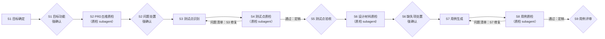

# 测试专家 Agent 设计文档

> 本文面向团队成员，说明双 agent（测试设计专家 `@test-expert` + 测试质检专家 `@test-qa-expert`）的工作方式与设计取舍。分工：**agent 文件只管流程编排**（阶段、门禁、状态、派发），**领域知识全在 skills**（定义、判据、检查单、模板），双方互相只引用、不复述，权威源缺的知识先落进 skill 再引用。测试点/测试用例的权威定义在 `test-point-spec` / `test-case-spec`，本文只转述要点，有出入以 skill 原文为准。

## 1. 它做什么

**输入** 项目目录下的 PRD、开发设计文档、数据字典等研发资产；**输出** 每条都能指回 PRD 原文的测试点（TP）与测试用例（TC）；**过程** 分 9 个阶段推进，5 处人工门禁（强确认）不通过不推进，4 个质检阶段由质检 subagent 执行。

| 老问题 | 对策 |
|---|---|
| 自己生成自己检查，质检走过场 | 双 agent：生成与修复归测试设计专家，检查与结论归测试质检专家（subagent）；S2/S4/S6/S8 一律派发质检 |
| 测试点无依据，指不回需求原文 | 每条 TP 挂 PRD 锚点并附 ≤40 字原文摘录，无依据禁止产出 |
| 粒度失控：按字段碎拆，或多条规则挤进一条 | TP 收拢到业务能力（三条切分标准）；数据、步骤等细节归 TC |
| 术语漂移：测试项/检查点/用例点混用 | TP、TC 各只有一处定义源，禁止口语变体 |
| 一致性漏检不稳定（两次运行结果不同） | 矛盾检测矩阵：检索交给工具，判定依据写明，结论留痕 |
| PRD 被静默替换 / 材料悄悄过期 | PRD 版本锁定 + 指纹核对：一经 S1 确定全流程锁定，暂不支持修改 PRD 文件 |

## 2. 核心概念：测试点与测试用例

### 2.1 一句话分清

| | 测试点（TP） | 测试用例（TC） |
|---|---|---|
| 回答的问题 | **验证什么**业务能力 | **具体怎么验** |
| 定义 | 一项供产品确认、能判定通过与不通过的业务验证目标 | 一条含完整执行信息的可执行验证，只验证一个目的（一个 pass/fail 结论） |
| 内容 | 验证意图 + PRD 依据（锚点+摘录） | 前置条件、测试数据、操作步骤、预期结果 |
| 判定方式 | 所含 PRD 要求全部满足才通过，任一不满足即不通过 | 按预期结果直接判定 |
| 数量关系 | 一条 TP 派生一至多条 TC（超 10 条须在质检记录写明原因） | 每条 TC 只能挂一个 TP |

### 2.2 测试点（TP）

测试数据、操作步骤、具体预期归 TC；TP 不按字段、输入值、角色逐项拆分，**数量不作为目标**。一条 TP 必须同时满足三条，缺一不许出：

| 硬标准 | 判据 | 典型违规 |
|---|---|---|
| ① 说得出出处 | 挂 PRD 原文锚点 + ≤40 字摘录，验证的事就是该句原文说的事；PRD 没写的须注明推导来源、挂最相关原文、不与明文矛盾；用户澄清结论登记后可作依据（澄清登记） | 无依据硬出；借一句话验它没说的内容 |
| ② 切得不多不少 | 同一业务能力下的并列条件合成一条；仅三种情况拆分：不同业务目标 / PRD 明文规定不同流程、规则、权限或结果 / 主副项验收不同 | 太大（多条规则塞一条）；太小（同一规则换数据就拆）；重复（明细验证与能力验证各出一条） |
| ③ 判得了对错 | 能回答「真执行了，看什么分出过/不过」 | 答不上来仍硬出 |

- PRD 对并列条件是否区别处理没说清 → 默认合并一条，同时把疑问记入问题清单要求澄清，不得自行补造规则；通过标准定不出来 → 标记待澄清，不算已确认基线
- 命名：「验证」+ 对象 + 结果方向，≤30 字；对象直抄 PRD 原词——名称是未来用例库的检索键，不自创同义词

| 示例 | 判定 |
|---|---|
| 验证超单笔限额的转账被拒绝 | ✅ 一条逻辑、一个结果方向、PRD 原词 |
| 验证转账功能正确 | ❌ 几条不同业务规则塞一条，没法判 |
| 验证输入 0 元和负数均被拒绝 | ❌ PRD 对两者写的是同一套处理，具体数据是用例的事 |

### 2.3 测试用例（TC）

执行者无需追问即可照做。十个字段：

| 字段 | 要求 |
|---|---|
| 编号 | `TC-<功能码>-NNN`，三位序号唯一、只增不改不复用 |
| 标题 | 「场景 + 预期」，如「金额超单笔限额，交易拒绝并提示」 |
| 关联 TP | 单个 TP 编号，禁止多值 |
| 优先级 | P0 核心主流程 / P1 重要分支与边界 / P2 次要场景 / P3 罕见与健壮性 |
| 前置条件 | 可构造的具体状态；环境/版本要求也写入此项，禁止「系统正常」类空话 |
| 测试数据 | 具体值，金额/字段给到具体数值 |
| 操作步骤 | 动词开头、编号分步、无歧义词 |
| 预期结果 | 可判定的具体值/文案/状态，多个结果分点写 |
| 用例类型 | 正向/反向/边界/异常/流程；交叉时按 边界>异常>反向>流程>正向 取首个命中 |
| 变更状态 | 预留字段，当前流程（S7/S8/S9）一律留空 |

## 3. 关键机制词典

| 机制 | 是什么 | 防什么 |
|---|---|---|
| 双 agent 分工 | 测试设计专家（主流程：编排、门禁、状态、S1/S3/S5/S7/S9、修复）+ 测试质检专家（subagent：S2/S4/S6/S8 质检，只检不修、不与用户交互） | 自己检自己走过场；质检员顺手改产物 |
| 项目/功能两层目录 | `qa-workspace/<项目名称>/` 放材料目录（产品需求文档/开发设计文档/数据字典），`<功能码>-<功能名>/` 放功能产物 | 材料与产物混放；功能目录与材料目录重名 |
| 派发单与越权核对 | 派发必含阶段、路径、材料、skill、模式、报告路径、禁止修改项；收回必核「实际写入文件列表 + validate.sh 退出码 + 结论」，授权报告外的写入视为越权，暂停报告不回滚 | subagent 权限全开下的误写无人发现 |
| 锚点 | PRD 原文的定位标记：PRD 自带编号就用原文编号，没有则按 `M<模块>-S<章节>-P<段落>` 生成 | 说不清验证的是 PRD 哪句话 |
| 锚点底册 | 01-scope.md 中的锚点清单表，全流程唯一溯源依据；S1 建立并验收后冻结（漏锚扫描确认补录为唯一例外） | 各阶段随手加锚、依据漂移 |
| 引用链登记 | S1 逐条登记「目标功能各处引用了哪些其他功能、操作入口归谁」，作为 S2 的检索入口 | 跨功能引用被漏检 |
| PRD 文本快照 | S1 用命令行工具把权威 PRD 转成纯文本落盘 `00-input/prd.txt`，禁止模型转写 | 模型转写改写原文 |
| 摘录逐字机验 | validate.sh 校验底册摘录 ≤40 字且逐字命中快照（比对前去除多余空白），TP 依据含对应底册摘录 | 凭空编造依据 |
| 版本指纹 | S1 登记权威 PRD 原文件 md5，每次开工重算比对 | PRD 被静默替换 |
| PRD 版本锁定 | 权威 PRD 一经 S1 确定全流程锁定；S2 门禁仅支持澄清/补充说明（登记不落原件）；指纹不一致 → 暂停，用户二选一（恢复原 PRD / 从 S1 重新开始） | PRD 文件中途变更导致底册、快照、指纹整体失效 |
| 澄清登记 | 用户澄清/补充说明的结论登记入 02 处置记录与 00-state，TP 依据可写「锚点 + 底册摘录 + 澄清登记」 | 口头澄清无据可查 |
| 漏锚扫描 | S2 末尾用功能名等原词在快照全文搜索，逐处判定「已建锚/疑似缺锚/范围外」；缺锚经用户确认并在 00-state.md 登记后补录 | 底册本身有遗漏而无人发现 |
| 强确认协议 | 门禁只接受三种答复：`通过` / `调整@<编号> <说明>` / `退回`，其他一律视为未确认；Blocker 带风险推进须 `通过 + 阶段名` 二次确认 | 「嗯」「先继续」被当成确认 |
| 门禁转移表 | 每个门禁的通过/调整/退回均有确定去向（S2 退回回 S1、S5 退回回 S3、S6 退回回 S5、S9 退回回 S7）；修改后的产物必须经质检复检 | 「退回」被随意解释；改完跳过质检 |
| 修复循环 | S3↔S4、S7↔S8：质检问题清单 → S3/S7 修复（质检记录表留痕）→ 复检（报告按轮次追加）→ 通过定稿 | 修复无痕；复检覆盖历史 |
| 问题分级处置方 | S4/S8 问题清单逐条标注级别（Blocker/Major）与处置方：产物级走修复循环；输入/基线级（PRD 歧义、材料缺口、TP 基线错误）立即暂停循环呈报用户 | 输入级问题在循环内硬编硬造 |
| 收敛保护 | 同一质检阶段连续 3 轮未收敛 → 暂停循环，用户裁定 | 无限空转 |
| 功能码 | ≤6 字符拼音/英文缩写（如 LBZS），仅用于 TP-/TC- 编号；引用功能名称必须与 PRD 原文逐字一致（规则见 prd-quality-check） | 编号占位与名称引用混淆 |
| 问题分级 | 仅两级：**Blocker**（无法定义或判定 TP/TC）/ **Major**（可暂定，但未决问题可能改变范围、拆分或验收结果）；不影响生成与判定的细节不进问题清单 | 细枝末节淹没关键问题 |
| S6 缺失衔接 | S6 带缺失项通过 → 缺口登记 00-state → S7 受影响 TP 不生成 TC，覆盖对照表登记「S6 缺失项 <编号>」→ 补齐后按材料变更协议恢复 | 带着材料缺口硬造 TC |
| TP 全覆盖豁免 | validate.sh 对 05 覆盖对照表显式声明未覆盖原因（非空非占位）的 TP 不计 FAIL，未声明的仍硬失败 | 豁免机制缺失导致合法留空被硬拦 |
| 产出模式 | **演示模式**（默认，不写文件，机器校验降级为对话内声明）/ **落盘模式**（写全套产物并按阶段跑 validate.sh）；两模式的阶段顺序、门禁、溯源要求完全一致，仅产物载体不同 | — |

## 4. 工作流：九个阶段

> 菱形 = 人工门禁（强确认，不通过不推进），共 5 处：S1/S2/S5/S6/S9。

| 阶段 | 执行者 | 做什么 | 产出 | 门禁 |
|---|---|---|---|---|
| S1 目标确定 | 主 agent | 用户输入项目名称 → 通读产品需求文档目录下权威 PRD（officeTool 分页读完）→ 列功能清单（名称逐字引原文、拟功能码）→ 用户指定目标功能 → 引用链登记 + 建锚点底册 → 生成快照、登记指纹 | 01-scope.md | 强确认：目标功能 |
| S2 PRD 质检 | 质检 subagent | 五维质检 + 矛盾矩阵比对 + 漏锚扫描（缺锚经确认补录） | 02-prd-check.md | 强确认：问题处置（仅澄清/补充说明） |
| S3 测试点识别 | 主 agent | 先广撒网列全覆盖维度，再按切分标准定成业务验证目标；承担 S4 产物级问题修复 | 03-test-points.md 草稿 | 无：进质检 |
| S4 测试点质检 | 质检 subagent | 语义关逐项核对 + 形式关跑脚本（03 参数） | 03-tp-check.md → 03 定稿 | 无：问题交 S3 修复，通过进验收 |
| S5 测试点验收 | 主 agent | 发起测试点验收；通过后 TP 即基线 | 00-state.md 确认记录 | 强确认 |
| S6 设计材料质检 | 质检 subagent | 逐份通读开发设计文档/数据字典（主 agent 只整理文件清单），五维 + 材料专项（规范见 tdd-quality-check） | 04-design-check.md | 强确认：缺失项处置 |
| S7 用例生成 | 主 agent | 基于验收 TP 与 S6 已确认材料生成十字段 TC；承担 S8 产物级问题修复 | 05-test-cases.md 草稿 + 覆盖对照表 | 无：进质检 |
| S8 用例质检 | 质检 subagent | 语义关逐项 + 形式关跑脚本（05 参数）；TP 全覆盖豁免校验 | 05-tc-check.md → 05 定稿 | 无：问题交 S7 修复，通过进评审 |
| S9 用例评审 | 主 agent | 发起用例评审；通过后登记并提示 git commit 留痕 | 00-state.md 确认记录 | 强确认 |

- **单一功能边界**：一次只做一个业务功能；切换须显式挂起并在 00-state.md 登记
- **状态恢复**：开工先读 00-state.md 并与各产物条目数核对；不一致先向用户求证，不盲信 state 也不盲信文件
- **基线管理**：验收通过的清单即基线，此后只做受控变更（失效/新增/修改）；编号只增不改不复用，禁止无差别重新生成
- **设计材料变更**：登记变更说明 → 受影响 TP/TC 标记失效 → 明确告知需重跑哪些阶段；PRD 文件变更暂不支持（版本锁定）

## 5. 质检机制（双 agent）

### 5.1 分工与派发

- 生成与修复归测试设计专家；检查与结论归测试质检专家（subagent），只检不修、不与用户交互
- 主 agent 派发必含：阶段、项目/功能路径、材料路径、需加载 skill、模式、报告路径、禁止修改项
- 收回核验：实际写入文件列表与派发单一致才接收；越权写入 → 暂停报告用户，不自动回滚

### 5.2 PRD 质检（S2）

五维检查：完整性、一致性、无二义性、可测试性、可追溯性。检查深度只要求 PRD 能支撑「有依据、范围清楚、结果可判定的业务级 TP」。能用工具查的不用模型猜，模型判断必须写明依据（一致性维度按矛盾检测矩阵执行，种子词表检索 + 两两比对留痕，详见 prd-quality-check）。

### 5.3 两关质检（S4/S8，规范见 self-review-checklist）

| 关 | 谁来做 | 查什么 |
|---|---|---|
| 语义关 | 质检 subagent 逐项 | 出处、切分、归组、命名、可判定、高风险判定、覆盖反向核对（逐锚点）、去重、名称与 01 登记原文逐字一致 |
| 形式关 | 脚本必跑 | S4 传 `03-test-points.md`、S8 传 `05-test-cases.md`（禁止 `all`）：编号格式与唯一性、必填字段、锚点底册引用与全覆盖、摘录逐字机验、TC→TP 引用完整、TP 全覆盖（含豁免） |

- **脚本 PASS ≠ 质检通过**；两关都过才可定稿提交门禁
- 问题清单逐条标注级别与处置方；产物级走修复循环，输入/基线级立即呈报用户
- **覆盖对照表**：S4 产出锚点→TP 对照、S7 产出 TP→TC 对照；未覆盖项必须显式填写原因，禁止留空

### 5.4 设计材料质检（S6，规范见 tdd-quality-check）

检查深度 = 支撑 TC 十字段生成；按前端设计文档/后端设计文档/数据字典/接口文档材料专项检查；以锚点底册核对 PRD 已明确约束的覆盖方式；带缺失通过时缺口登记并衔接 S7 豁免生成。

## 6. 安全边界

- **输入只读**：PRD/设计文档/数据字典不替用户修改；S2 对 PRD 仅支持澄清/补充说明（登记不落原件）
- **产物隔离**：一切产物只写 `qa-workspace/<项目>/<功能>/`；不执行删除类命令
- **读完再判**：超长文档分页读完，禁止只读首屏下结论；流程图/截图等不可解析内容显式声明「文本范围外信息缺失，测试点可能不全」并登记缺失项

## 7. 文件地图

| 文件 | 职责 |
|---|---|
| `.opencode/agents/test-expert.md` | 主流程 agent：编排、门禁、状态管理、S1/S3/S5/S7/S9、TP/TC 修复、质检派发 |
| `.opencode/agents/test-qa-expert.md` | 质检 agent（subagent）：S2/S4/S6/S8 质检；只检不修 |
| `.opencode/skills/test-point-spec/` | TP 唯一定义源：切分判据、命名、清单模板 |
| `.opencode/skills/test-case-spec/` | TC 唯一定义源：十字段、质量标准、清单模板（含预留变更状态列） |
| `.opencode/skills/prd-quality-check/` | PRD 五维质检、锚点规则、矛盾检测矩阵、三问判据、问题分级（含 baseline/ 素材记录） |
| `.opencode/skills/tdd-quality-check/` | 设计材料质检：五维 + 前端/后端设计文档、数据字典、接口文档专项、04 报告模板 |
| `.opencode/skills/test-analysis-methods/` | 八种方法选用矩阵、银行/Web/接口领域检查单 |
| `.opencode/skills/self-review-checklist/` | S4/S8 质检清单、问题分级与处置方、覆盖对照表、validate.sh |
| `qa-workspace/<项目名称>/<功能>/` | 运行时产物：00-state、01-scope ~ 05-tc-check + 00-input 快照 |
