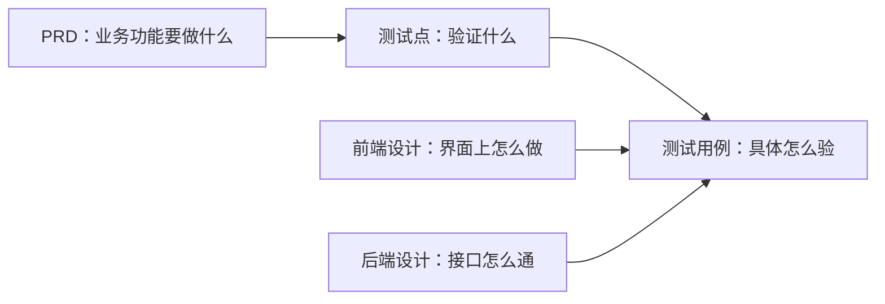

# 前端设计编写约束要求

> **给谁看**：前端开发设计的撰写人，在文档交稿前使用。
> **解决什么**：功能有操作界面时，这份文档是生成测试用例的**必需输入**——测试用例的操作步骤、预期结果、前置条件、测试数据主要从这里取材。用例资料质检阶段会先检查它「可读且足以支撑用例生成」，缺关键内容会暂停用例生成、请你补充。**本文只讲怎么写能一次过，不替代质检本身。**
> **粒度定位**：这份文档与对应 PRD 一一配套，**只写同一个业务功能**；描述深度到「页面与交互」层，不拆组件级实现。

## 你的文档会被这样使用



测试用例第一次能照着写出「操作步骤＋预期结果」，靠的就是这份文档：PRD 说「业务上要什么」，你说「界面在哪点、输入什么、做完看到什么」。

## 前提：一份文档 ＝ 一个业务功能（配套 PRD）

- **对号入座**：文档服务于哪份 PRD，在元信息写明对应需求 ID 与业务功能名称；测试流程按业务功能一对一套用 PRD + 前端设计 + 后端设计。
- **不拆层级**：整份文档围绕这一个业务功能的页面与交互展开，不再拆内部功能先后成章；页面内部实现（组件结构、代码方案）不进文档。
- **跟 PRD 口径走**：界面上出现的规则、文案以 PRD 为准；设计自行补充的内容不得与 PRD 矛盾——冲突会把相关用例打回澄清，多耗两轮流程。
- **标题要与身份一致**：这是前端设计文档，不写成「产品需求文档」；标题错位会误导检查定位（配套示范文档就有此问题，交稿时请改）。

## 三步写完一份合格的文档

### 第一步：按 8 章搭骨架（对照参考文档整理）

| 章 | 写什么 |
|---|---|
| 1 文档概述 | 背景、技术栈、**对应需求 ID 与业务功能名称** |
| 2 页面清单 | 这一个业务功能的页面逐个列：页面 ID、名称、一句话描述、所属流程 |
| 3 页面详细描述 | 每页四样：页面功能 / 页面布局 / **交互功能（每个按钮和跳转逐条写）** / 关键视觉元素 |
| 4 业务流程设计 | 页面间跳转路径图 + 文字步骤（怎么进去、怎么返回、在哪里分支） |
| 5 数据模型 | 界面展示与提交涉及的数据对象：字段、格式、取值枚举 |
| 6 功能验收标准 | **每页一份可勾选清单**：显示什么、点什么、跳到哪、出什么提示 |
| 7 业务规则落地 | PRD 规则在本端的表现：校验时机、提示文案、置灰/禁用条件 |
| 8 非功能与异常兜底 | 兼容与适配、会话行为、性能数值、防重复提交、弱网/中断表现 |

> 用例资料质检阶段专门按五样检查前端设计：**页面与操作入口、交互事件、提示文案、前端校验规则、兼容性说明**——第 2/3/6/7/8 章分别对上，缺哪样补哪样。

**测试用例要什么 ← 从哪里取**（写文档时对着这张表自查）：

| 测试用例要素 | 从这份文档哪里取 |
|---|---|
| 操作步骤（点什么、输什么） | 第 3 章交互功能 + 第 4 章跳转步骤 |
| 预期结果（看到什么提示、跳到哪页） | 第 6 章验收标准 + 第 7 章提示文案 |
| 前置条件（登录态、账户/产品状态） | 第 3 章状态展示 + 第 5 章状态枚举 |
| 测试数据（金额格式、存期取值） | 第 5 章字段格式与枚举 |
| 异常/健壮性场景（断网、重复提交、会话过期） | 第 8 章 |

### 第二步：每个页面按这个填空

```markdown
### <页面ID> <页面名称>

**页面功能**：<一句话：给谁用、干什么>

**页面布局**：<区块划分：顶部/中部/底部各放什么>

**交互功能**：
- <点/选/输入什么 → 什么反馈，或跳到哪个页面>
- <每个按钮一条；置灰/禁用条件写明>

**状态展示**：
- <空数据/加载中/失败>：<怎么显示>
- <售罄、停售、提示型状态（如 II 类户）>：<显示什么>

**校验时机**：
- <输入时即时校验的规则>：<提示什么>
- <提交时拦截的规则>：<拦截后提示什么>

**验收标准**：
- [ ] <展示：页面内容齐全>
- [ ] <交互：点 X → 跳转/提示 Y>
- [ ] <校验：非法值 → 输入时/提交时出什么提示>
```

写成什么样算好——参考文档「购买确认页」收拢后的成品：

```markdown
### confirmPage 购买确认页

**页面功能**：客户确认购买信息并提交申请；提交前完成付款账户与到期处理方式选择、风险提示确认

**页面布局**：顶部购买信息汇总；中部表单（付款账户、金额、存期、到期处理方式）；下部风险提示；底部提交按钮

**交互功能**：
- 点付款账户选择器 → 弹出账户列表，选中后展示该账户可用余额
- 到期处理方式 → 单选（不转存 / 自动转存）
- 风险提示 → 展示利率锁定、提前支取规则；确认复选框未勾选时「提交购买」置灰
- 「提交购买」→ 校验通过后跳转交易结果页；「返回」→ 回购买试算页
- II 类户 → 显示限额提示：日累计 1 万、年累计 20 万

**校验时机**：
- 起存金额、递增单位 → 输入金额时即时提示
- 余额不足、单户上限、单日限额 → 提交时拦截：提示缺口金额 = 购买金额 − 可用余额，
  或超限类型与剩余额度

**状态展示**：
- 提交后系统处理中 → 提示「处理中，请稍后查询」，不引导重试
- 重复点击「提交购买」→ 只提交一次（防重复）

**验收标准**：
- [ ] 购买信息汇总展示产品、金额、存期、利率，与上一页所选一致
- [ ] 风险确认复选框未勾选时无法提交
- [ ] II 类户提交超过日累计 1 万 → 拦截并提示限额类型与剩余额度
- [ ] 余额不足 → 拦截并提示缺口金额
- [ ] 提交成功 → 跳转交易结果页
```

### 第三步：交稿前三遍查

1. **对着 PRD 过一遍**：PRD 每条规则在文档里有落点（校验/提示/置灰一种）；文档补写的内容不与 PRD 矛盾；拿不准时以 PRD 为准回改
2. **每页数四样**：页面功能、布局、交互（每个按钮都有去向）、验收清单；每条校验写明「输入时还是提交时」
3. **过清单**：把文末「交稿自检清单」逐条打勾

**一句话判定写没写够**：交给一个没参与讨论的测试同事，只看这份文档就能写出可执行的用例——点了什么、输入什么、待在什么状态、看到什么结果——做不到，就是没写够。

## 十条黄金规则

| # | 规则 | 一行说明 |
|---|---|---|
| 1 | 一个文档一个业务功能，与 PRD 配套 | 元信息写对应需求 ID；文档内不再拆层级、不再另立范围 |
| 2 | 跟 PRD 口径走 | 规则、提示文案以 PRD 为准；两处描述不同＝最高优先级问题 |
| 3 | 页面清单齐全，一页一小节 | 每页四样齐：功能 / 布局 / 交互 / 验收 |
| 4 | 每个按钮和入口写明去向 | 跳哪页、弹什么、提交什么，置灰禁用条件一并写；同一入口全文只说一套 |
| 5 | 校验时机写明 | 输入时即时提示、提交时拦截，各管哪些规则分得清 |
| 6 | 提示写到能照抄 | 缺口金额、超限类型与剩余额度、「处理中不引导重试」等关键提示点写全 |
| 7 | 状态展示写全 | 空数据/加载/失败、售罄/停售、提示型状态（II 类户）、登录态过期各是什么样 |
| 8 | 跳转闭环 | 每页进得去、回得来；提交被中断（弱网/重复点击）后页面是什么状态有交代 |
| 9 | 数据模型给到能造数 | 字段格式、枚举（如可售/停售/售罄）、金额精度、日期格式、存期取值 |
| 10 | 非功能写「看得见的现象」 | 兼容到什么、性能给数值或标「待确认」、防重复提交的表现；不写无法验证的空话 |

## 全文自检：用例环节怎么查你

| 检查环节 | 你要写成什么样 |
|---|---|
| 资料质检查「能否支撑用例生成」 | 操作入口、字段约束、枚举、状态定义、异常路径都能从这里拿全，不用追问 |
| 一致性查「设计与 PRD 匹配」 | 界面文案与 PRD 同源；与后端设计的接口字段、错误码对得上 |
| 无二义性查「一步一种读法」 | 一个动作只有一种含义：「点提交」到底是校验还是直接提交，写唯一 |
| 可测试性查「结果看得见、数据造得出」 | 每条验收都是「做 X → 看 Y」；字段格式与枚举足够造测试数据 |
| 用例质检反推「设计缺口」 | 写不出操作步骤 = 交互漏了；定不了预期结果 = 提示/验收漏了；造不出前置 = 状态漏了——被反推出缺口就去补设计 |

**最容易打架的六处**（前端设计高发区，每处全文只说一套）：

> 页面行为与 PRD 规则不一致 · 同一按钮/入口两处说法不同 · 校验时机（输入时/提交时）散落多处拼不齐 · 提示文案与 PRD 描述不同 · 空状态/售罄/停售等状态展示遗漏 · 断网/重复提交兜底缺失

## 交稿自检清单

- [ ] **范围收敛：只写对应 PRD 的那一个业务功能**，与 PRD 一一配套
- [ ] 文档标题与身份一致（前端设计，不写成需求文档）
- [ ] 文档是 md/txt，交互说明用文字与表格，关键流程不以纯截图承载
- [ ] 页面清单与页面小节一一对应，每页四样齐（功能/布局/交互/验收）
- [ ] 每个按钮/入口都有明确去向，无两处矛盾
- [ ] 校验时机写明（输入时/提交时），且与 PRD 一致
- [ ] 关键提示按 PRD 落地（缺口金额、超限类型与剩余额度、处理中不引导重试、证件过期引导）
- [ ] 状态展示写全（空/加载/失败/售罄/停售/提示型状态/登录态过期）
- [ ] 跳转闭环：每页进得去回得来，提交中断后状态有交代
- [ ] 数据模型字段格式/枚举给出（金额精度、日期格式、状态枚举、存期取值）
- [ ] 兼容/会话/弱网/防重复提交有现象级描述；给不出的标「待确认」
- [ ] 与后端设计的接口字段、错误码对齐
- [ ] 「待确认」事项集中列在一处
